# D-45 report controls — AI #4

Profit and loss and balance-sheet date, Basis, Label and comparison controls now use
the current theme's text/background variables. Native date fields inherit the
theme's colour scheme. The balance-sheet control groups wrap instead of clipping
Sort at the right edge. Header inputs and buttons have 44px targets, and Basis
has an explicit accessible name. No calculation, data fetching, posting, period
semantics or export payload changed.

This applies UI guide dark-mode, phone and accessibility rules. W5 remains
incomplete: readable controls and header checks do not prove label allocation,
balancing or the complete report workflow. No financial verification or browser
journey cell is promoted to Yes.

## Before / after

These crops use the same local Chromium, civil date, guest records and fonts on
both sides. They are review evidence, not replacement CI reference images.

| Report / viewport / theme       | Before                                              | After                                              |
| ------------------------------- | --------------------------------------------------- | -------------------------------------------------- |
| P&L / desktop / light           | 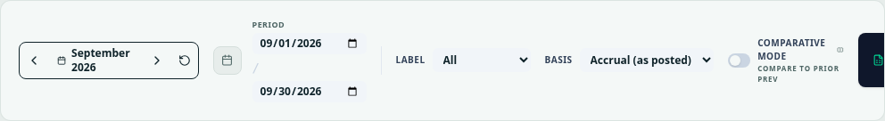           | 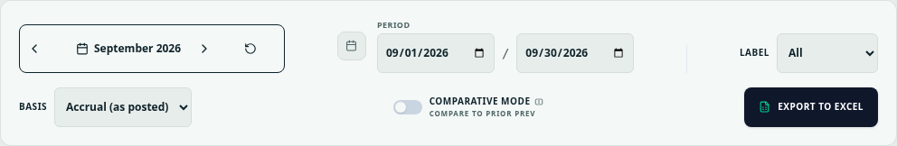           |
| P&L / desktop / dark            | 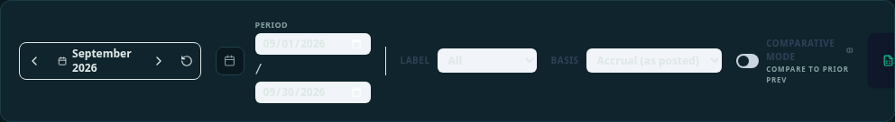            | 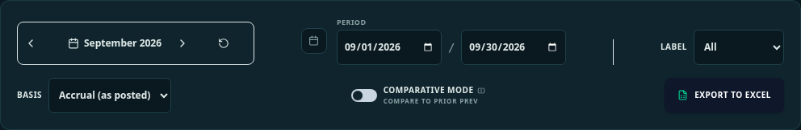            |
| P&L / phone / light             | 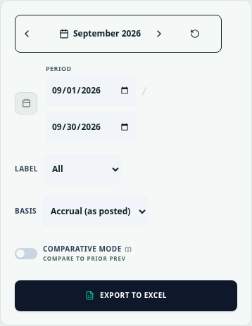            | 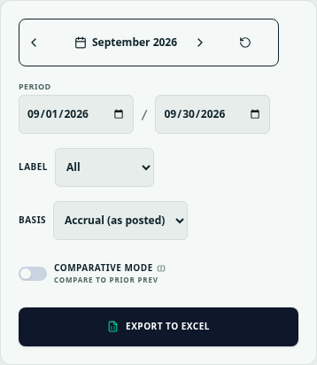            |
| P&L / phone / dark              | 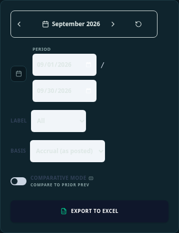             | 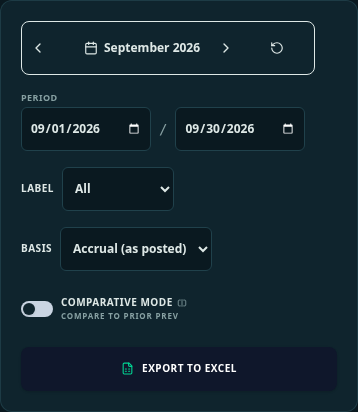             |
| Balance sheet / desktop / light | 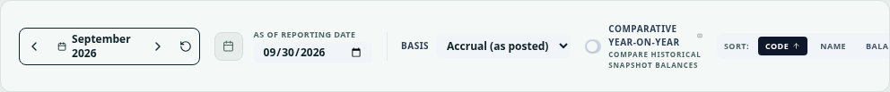 | 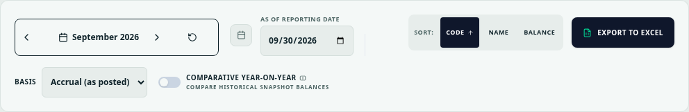 |
| Balance sheet / desktop / dark  | 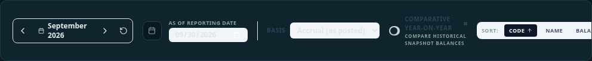  | 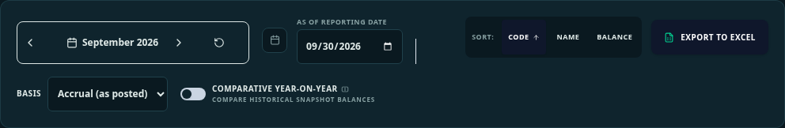  |
| Balance sheet / phone / light   | 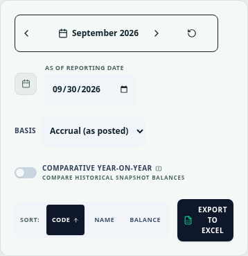  | 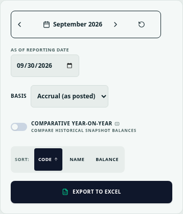  |
| Balance sheet / phone / dark    | 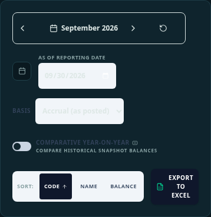   | 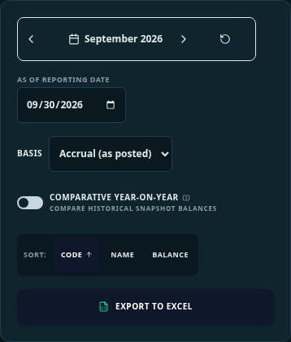   |

## Checks

`e2e/report-header.spec.ts` checks both reports at 390 and 1280px in light/dark:
axe colour contrast, actual native-field text/background WCAG ratios ≥4.5:1,
44px controls, no controls extending beyond their header, editable dates,
keyboard focus on Basis and functional balance-sheet sort selection.

Local Chromium: eight cases pass; full typecheck passes; targeted ESLint has no
errors and one existing P&L effect warning (unchanged). Installed dependencies
match the lockfile; no fresh local install is claimed.

The existing **Refresh visual baselines** workflow captures the eight affected
CI-Chromium references and checks the entire reference set. A temporary branch-only
push trigger permits this session to run that workflow because its connector has
no dispatch operation; it is removed before the final PR checks. Candidate images
must be inspected before acceptance. No threshold or assertion is relaxed.

Full fresh-install, accounting/RLS/coverage, both timezone suites, production build,
browser and security gates run on GitHub. Their exact-head results and candidate
image review are recorded in the PR. Vercel previews remain intentionally blocked
by the owner to save limits; no deployment retry or success is claimed.

CI reference capture: run 39163910254 passed, generated exactly the eight affected P&L/balance-sheet images, and all 40 visual reference cases passed. All eight candidate images were opened and inspected before acceptance: dates/Basis are readable, balance-sheet sorting is fully visible, and report figures remain visible. The temporary push trigger was removed; the final workflow matches main. Full final-PR gates remain pending at publication.
