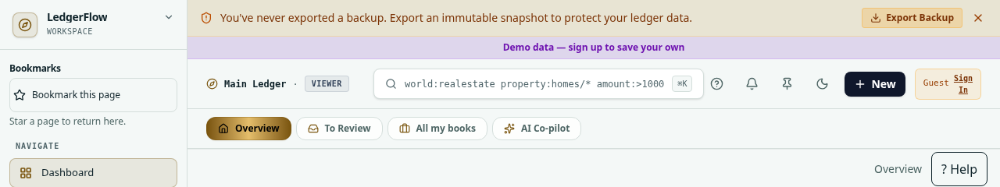
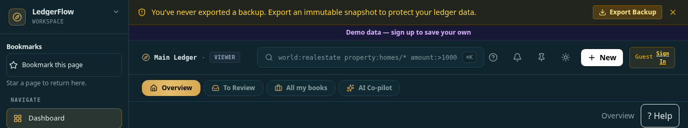
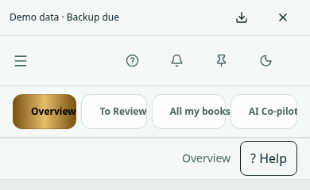
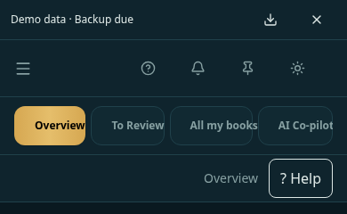

# D-46 mobile notices — AI #4

On phones, backup and demo-data notices share one row, at most 48px high, with
44px keyboard-accessible backup and dismiss buttons. Dismiss hides both notices
for the current mounted session; changing the book or guest/user identity resets
the notice state. Backup completion updates the row immediately using the existing
backup event and health helper. The backup action keeps its existing Settings
navigation; it does not claim a backup was exported.

Desktop backup and demo notices keep their existing separate presentation and
backup-dismiss behavior. Connection and deletion warnings are unchanged. No
financial logic, backup format, restore code or saved ledger data changed.

This follows UI guide phone, states and accessibility rules. W1/W10 receive
notice-only browser evidence; their complete first-hour/backup-restore journeys
remain unverified here, with no release-gate cell promoted to Yes.

## Before / after

Same local Chromium, guest records, fixed date and fonts; captures show the top
240px. These are review evidence, not CI reference replacements.

| View          | Before                                | After                                |
| ------------- | ------------------------------------- | ------------------------------------ |
| Desktop light |  |  |
| Desktop dark  |   |   |
| Phone light   |   |   |
| Phone dark    |    |    |

## Verification

- Four Chromium cases pass: light/dark at 390 and 1280px, a single compact mobile
  notice row, no overflow, ≤48px height, 44px buttons, axe accessibility/contrast,
  keyboard Settings navigation and dismissal, unchanged desktop dismissal, and
  session-local dismissal resetting on reload.
- One stateful component case passes in Auckland and Los Angeles: signed-in
  backup-only, combined guest, dismissal, workspace reset, real backup-completion
  event, demo-only, fresh signed-in/no notice and another book's backup reminder.
  Its JSDOM fixture uses the browser's CustomEvent constructor so the actual event
  helper executes in the correct realm; production event code is unchanged.
- Full typecheck passes. Targeted lint has zero errors and five existing warnings
  (the backup effect and four unrelated RootLayout variables), unchanged in count.
- Dependencies match the lockfile; no fresh local install is claimed. Full
  install/accounting/RLS/coverage/timezone/build/browser/security gates run on GitHub.

D-45 is a dependency so both changes share correct visual references. The existing
Refresh visual baselines workflow captures the complete reference set for this
layout change; all candidates must be inspected before acceptance. Its temporary
branch-only trigger is removed before the final PR checks, with no relaxed
thresholds or assertions. Exact-head results are recorded in the PR.

Vercel remains intentionally disabled by the owner to avoid limits. No deployment
retry, re-enable or deployment success is claimed.
